  

  

## Building with intent

I'm Syed Ziyanuddin, a founder-engineer focused on turning useful ideas into thoughtful software products. I build across web, mobile, and backend systems—working with React, React Native, Expo, Swift, SwiftUI, Node.js, and modern JavaScript to take products from architecture through to shipping.

I'm especially interested in practical AI integrations, product engineering, and the systems that make a SaaS business easier to build and evolve.

## Selected products

<table>
  <tr>
    <td width="50%" valign="top">
      <h3>Emiridian</h3>
      
A white-label SaaS platform for customer retention, loyalty, bookings, and engagement.

      Public project link: <em>to be added</em>
    </td>
    <td width="50%" valign="top">
      <h3>Harvey</h3>
      
An AI-assisted legal application concept for case workflows, document analysis, and legal research.

      Public project link: <em>to be added</em>
    </td>
  </tr>
</table>

Next build: reserve this space for a future product, open-source release, or case study.

## Technology inventory

A practical inventory of technologies I build with, use, or explore—not a claim of equal proficiency in every tool.

### Current product stack

  
<strong>Languages & native development</strong>

   

  
<strong>Frontend, UI &amp; app architecture</strong>

   

  
<strong>Backend & integrations</strong>

   

  
<strong>Data, caching &amp; machine learning</strong>

   

  
<strong>Cloud, hosting &amp; DevOps</strong>

   

  
<strong>Design & creative tools</strong>

   

  
<strong>Games, 3D &amp; hardware</strong>

   

  
<strong>Development tooling</strong>

   

## GitHub activity

  

  

The activity card uses publicly available GitHub data. The contribution animation is generated weekly after the workflow below runs for the first time.

  
<strong>Contribution animation setup</strong>

   

The [workflow](./.github/workflows/snake.yml) writes the generated SVG to an `output` branch every Monday. It uses GitHub's built-in `GITHUB_TOKEN`; no personal token or custom secret is needed. If this repository's Actions token is read-only, enable **Settings → Actions → General → Workflow permissions → Read and write permissions**, then run **Generate contribution animation** once after pushing.

## Connect

  

LinkedIn, portfolio, and a public contact address have intentionally been left as placeholders until their correct URLs are supplied.

<!-- Replace the placeholder above with verified public contact links. Do not publish a personal email address unless intended. -->

  

